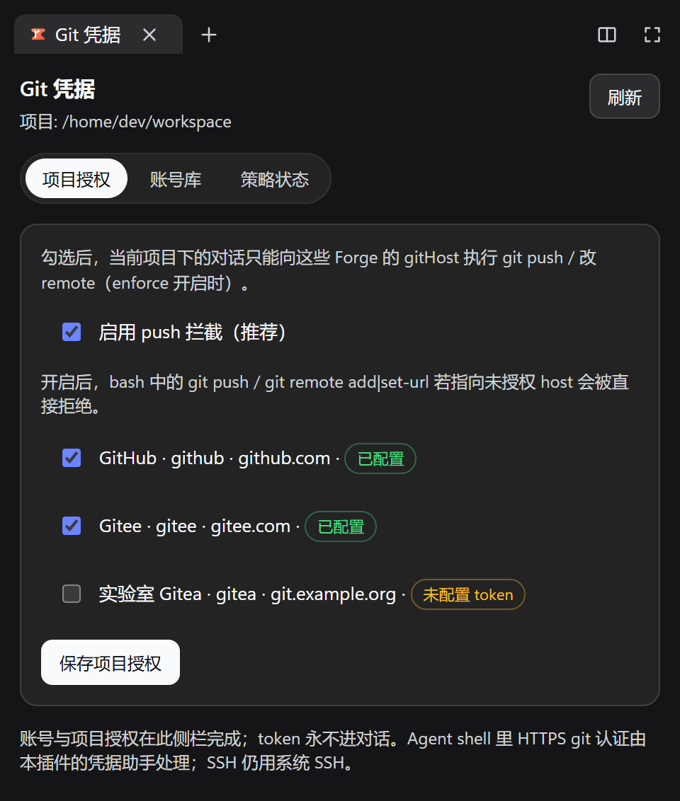
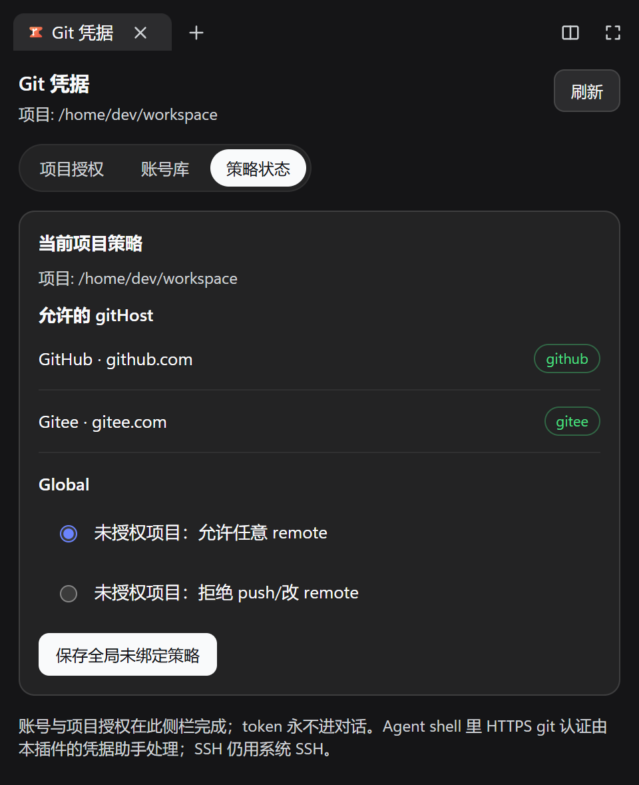

<p align="center"><strong>简体中文</strong> | <a href="README_en.md">English</a></p>

<div align="center">
<h1><br>DSH Git Forge</h1>

  <p>DeepSeek Harness 的 Git 凭据与推送权限管理器：哪个项目能用哪个账号、允许推到哪些 host，一处说清。</p>
  <p>工作区授权决定 HTTPS 凭据；宿主为 Bash 和 PowerShell 中指定的 Git 命令做预检。</p>

  <p>
    <a href="https://www.npmjs.com/package/dsh-git-forge"></a>
    <a href="https://github.com/deepseek-ai/dsh"></a>
    <a href="LICENSE"></a>
    <a href="https://github.com/OMSociety/dsh-git-forge/stargazers"></a>
    <a href="https://github.com/OMSociety/dsh-git-forge/issues"></a>
  </p>

<a href="#这是什么">这是什么</a> • <a href="#效果">效果</a> • <a href="#安装方式">安装方式</a> • <a href="#侧栏">侧栏</a> • <a href="#模型工具">模型工具</a> • <a href="#数据放在哪">数据放在哪</a> • <a href="#安全">安全</a> • <a href="#环境要求">环境要求</a> • <a href="#开发">开发</a> • <a href="#支持与致谢">支持与致谢</a> • <a href="#许可证与作者">许可证与作者</a>
</div>

## 这是什么

**DSH Git Forge** 是 [DeepSeek Harness](https://github.com/deepseek-ai/dsh) 的社区插件，在 DSH 官方右侧栏里给你一个 **Forge 账号库 + 按项目授权 + 推送策略** 的管理面。

它管两件事：

- **agent 用哪份凭据**：在侧栏给项目授权账号之后，agent shell 里的 HTTPS `git fetch` / `git push` 由本插件的 credential helper 自动取用对应 token，token 只在宿主侧读，**不进模型上下文**。
- **Git 命令预检**：开启策略时，宿主对 Bash、PowerShell 工具中直接调用的 `git push`、`git remote add`、`git remote set-url` 核对已授权 Git 主机。

SSH 远程与系统 `gh auth` 不受影响，仍走本机 SSH / `gh`；本插件只补 **DSH agent shell 下的 HTTPS** 这一段。

## 效果

<table>
<tr>
<td width="50%" align="center"></td>
<td width="50%" align="center"></td>
</tr>
<tr>
<td align="center">项目授权：勾选本项目可用的 forge 账号，并决定是否启用 push 拦截</td>
<td align="center">策略状态：当前项目允许的 gitHost，以及未绑定项目的全局策略</td>
</tr>
</table>

## 安装方式

**从 npm 安装**

```powershell
# 先停掉正在运行的 DSH（运行中的服务会锁住依赖，装完再起）
dsh plugin --profile desktop add "dsh-git-forge@1.3.0"
```

> **提示**：装好后**刷新一下浏览器页面**，「Git 凭据」从右侧栏的引导页打开——只重启宿主不够，客户端产物是页面加载时取的。

**装完怎么用**

1. 打开右侧栏「Git 凭据」→ **账号库** 加一个账号（token 只在侧栏里填，不进对话）
2. 点探测确认这个 token 有效
3. 切到 **项目授权** → 勾上该账号并保存，当前工作区就拿到了推送凭据
4. 让 agent 在项目里跑 HTTPS 的 `git fetch` / `git push`，凭据由 helper 自动注入，模型看不到 token
5. 用 `GitForge action=check_remote` 查看目标是否符合策略，此检查不发起推送。

## 侧栏

侧栏只有一个 Tab，内部三页：

| 页面 | 作用 |
|---|---|
| **项目授权** | 当前项目可用的账号，以及是否 `enforcePush` |
| **账号库** | 账号增删改、探测 API token；账号按 `gitHost` 归集，界面给出 `github.com` / `gitee.com` / `gitlab.com` / `bitbucket.org` 常用选项，自建 Forge 直接填自己的域名 |
| **策略状态** | 当前允许的 `gitHost`，以及未绑定项目的默认策略 |

## 模型工具

| 动作 | 作用 | 参数 |
|---|---|---|
| `GitForge action=list_accounts` | 列出账号库（不含 token） | 无 |
| `GitForge action=list_project_accounts` | 列出某项目已授权的账号 | `project_path` |
| `GitForge action=get_policy` | 看该项目策略：授权账号、是否 `enforcePush`、未绑定项目默认 | `project_path` |
| `GitForge action=check_remote` | 校验某个 remote URL 是否被允许推送（不推送） | `url`（必填） |

### Agent HTTPS 与项目路径

- 授权 key = **DSH 会话工作区**（agent shell 里注入 `DSH_GIT_FORGE_PROJECT`），不是子仓路径；工作区路径按磁盘实态归一（realpath），Windows 8.3 短名与符号链接折叠到同一 key
- helper 只用宿主提供的会话工作区；缺少有效会话时，侧栏显示未绑定，项目授权不可保存。
- R1：同一 host 仅当恰好 **1** 个已授权 **token** 账号时才自动注入凭据
- 宿主生成的 Git 配置优先包含显式 `GIT_CONFIG_GLOBAL`；未设置时依次包含 XDG Git 配置、`~/.gitconfig`。随后清空 helper 列表并挂载 Forge helper；停用时恢复原环境。

## 数据放在哪

`$DSH_HOME/git-forge/`（目录 `0700`；`0600`/`0700` 权限仅在 POSIX（Linux/macOS）生效，Windows 无等效收紧）：

| 文件 | 内容 |
|---|---|
| `accounts.json` | 账号元数据（不含 token） |
| `secrets.json` | token（`0600`） |
| `grants.json` | `projectPathKey → accountIds[]` 与 enforce / unbound 策略 |
| `gitconfig` | 注入给 agent shell 的 credential helper 配置（不含凭据） |

> **注意**：JSON 解析失败时先将原文件归档为 `<原名>.corrupt-<UUID>`，再使用默认值；读取或归档失败即中止。请先备份原文件并修复权限或 JSON，再保存。

## 安全

- token 不出现在 API 结果、工具结果与模型上下文里
- 策略状态页和 `get_policy` 显示已保存的 Git 主机授权；命令预检以此核对 Git 访问目标。API 端点用于账号探测。选择 SSH 会清除本账号已存 token，SSH 认证交给系统。
- 项目授权为空时，命令预检默认放行，凭据助手返回空凭据结果。
- token 只落在宿主侧数据目录 `secrets.json`；helper 是由 git 拉起的独立进程，按需读取；token 不进模型上下文。`secrets.json` 疑似泄露请立即轮换 token
- 管理请求先鉴权再读正文。**0.2.2-rc.5 专属适配**：仅接受 `connection.admit(req)` 认证出的浏览器 owner 单例，注册的 API Peer 不能管理。**0.2.3-alpha.2**：使用 WebServer 传入的第三参 Peer，要求其 principal 为 `owner`。缺少所有者证明即拒绝。
- 命令预检覆盖 Bash 和 PowerShell 中直接调用的 `git push`、`git remote add`、`git remote set-url`。进程隔离与网络出口控制由操作系统负责。
- 配置了授权的项目里，裸 `git push` 的 remote 解析失败会重试一次，仍失败即拒绝（fail-closed）

## 环境要求

- DSH profile。离线契约测试覆盖 `0.2.2-rc.5` 与 `0.2.3-alpha.2`。
- Node.js `>= 20`

## 开发

Bash / PowerShell:

```text
npm test
npm run check
npm run check:pack
npm run build:preview
```

目录与「改东西去哪」：

```text
lib/index.js            宿主入口：工具注册、/dsh-git-forge/api 路由、Git 命令预检、credential helper 配置
lib/client.js           客户端 bundle（已入库；dsh plugin add 不做构建）
lib/shared/             Node 模块：path、remote-resolve；平台无关规则：account-summary、credential-select、git-policy
docs/preview/           预览输入：fixture.json 为虚构数据，panel.html 与 docs/panel-*.png 由 build:preview 生成
scripts/                Git 凭据助手、离线测试、包清单检查与预览图生成
cordis.patch.yml        包内 bundle patch，CLI 据此写入 dsh.profile.bundles
```

## 支持与致谢

- 如果这个插件对你有帮助，欢迎点亮 Star；有问题或建议请提 [Issue](https://github.com/OMSociety/dsh-git-forge/issues) 或 [Pull Request](https://github.com/OMSociety/dsh-git-forge/pulls)。
- 变更记录见 [CHANGELOG](CHANGELOG.md)。
- [DeepSeek Harness](https://github.com/deepseek-ai/dsh)：插件、工具与 agent shell 的宿主

## 许可证与作者

[MIT](LICENSE)。上游项目与代码作者 [@thirsty5034](https://github.com/thirsty5034)；本仓库的维护与新增部分 © 2026 [@OMSociety](https://github.com/OMSociety)。
