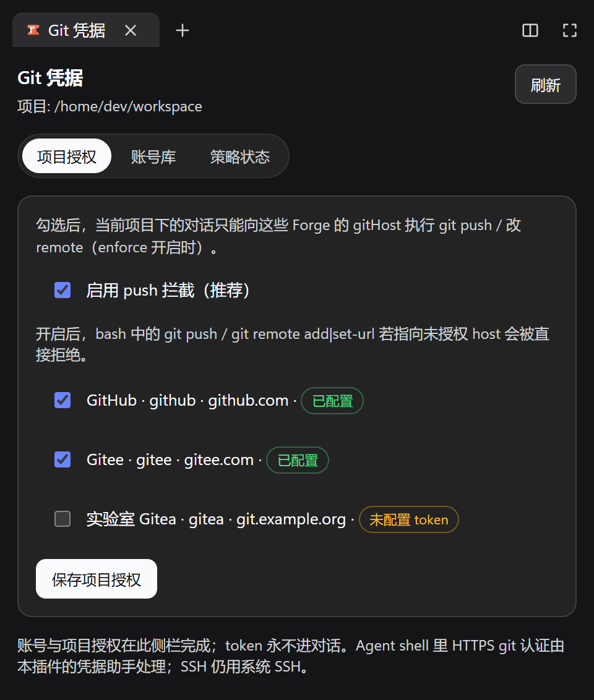
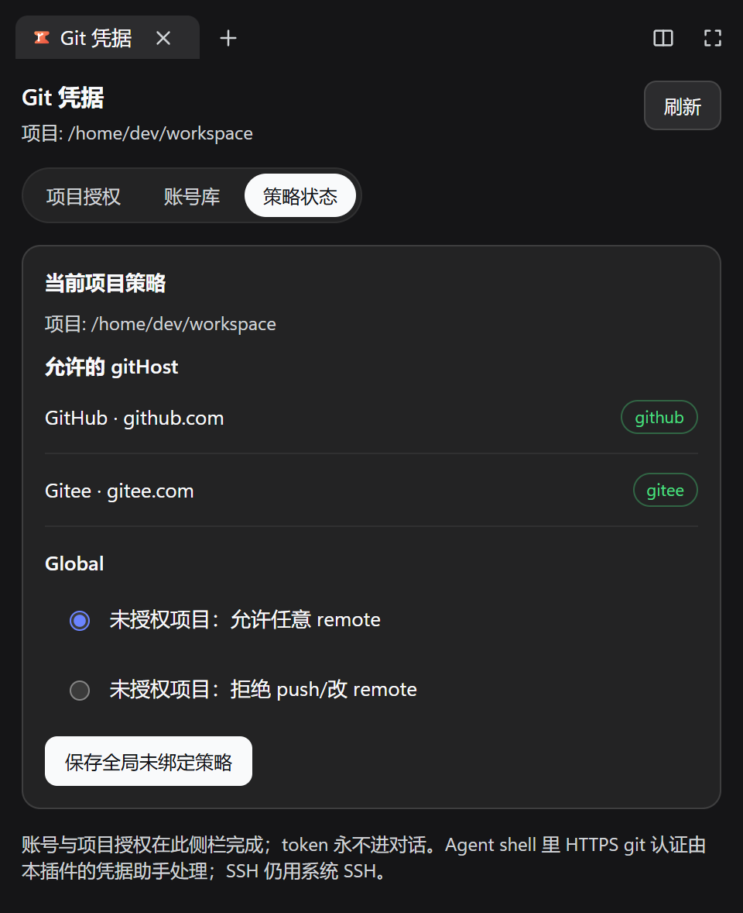

<p align="center"><a href="README.md">简体中文</a> | <strong>English</strong></p>

<div align="center">
<h1><br>DSH Git Forge</h1>

  <p>Git credentials and push policy for DeepSeek Harness: which project may use which account, and where it is allowed to push.</p>
  <p>Workspace grants select an HTTPS credential. The host preflights selected Git commands in Bash and PowerShell.</p>

  <p>
    <a href="https://www.npmjs.com/package/dsh-git-forge"></a>
    <a href="https://github.com/deepseek-ai/dsh"></a>
    <a href="LICENSE"></a>
    <a href="https://github.com/OMSociety/dsh-git-forge/stargazers"></a>
    <a href="https://github.com/OMSociety/dsh-git-forge/issues"></a>
  </p>

<a href="#what-this-is">What this is</a> • <a href="#screenshots">Screenshots</a> • <a href="#installation">Installation</a> • <a href="#sidebar">Sidebar</a> • <a href="#model-tool">Model tool</a> • <a href="#where-data-lives">Where data lives</a> • <a href="#security">Security</a> • <a href="#requirements">Requirements</a> • <a href="#development">Development</a> • <a href="#support-and-credits">Support and credits</a> • <a href="#license-and-author">License and author</a>
</div>

## What this is

**DSH Git Forge** is a community plugin for [DeepSeek Harness](https://github.com/deepseek-ai/dsh). In the DSH right sidebar it gives you one place to manage a **forge account library, per-project grants and push policy**.

It governs two things:

- **Which credential an agent uses.** Once a project is granted an account, HTTPS `git fetch` / `git push` in agent shells pick up that account's token through this plugin's credential helper. Tokens are read host-side only and **never enter model context**.
- **Git preflight**: when enforcement is enabled, direct `git push`, `git remote add` and `git remote set-url` in the Bash and PowerShell tools are checked against granted Git hosts.

SSH remotes and the system `gh auth` are untouched and keep using your local SSH / `gh`. This plugin only covers **HTTPS in DSH agent shells**.

## Screenshots

<table>
<tr>
<td width="50%" align="center"></td>
<td width="50%" align="center"></td>
</tr>
<tr>
<td align="center">Per-project grants: choose the forge accounts this project may use, and whether to enforce the push guard</td>
<td align="center">Policy status: the gitHosts allowed for this project, plus the global policy for unbound projects</td>
</tr>
</table>

## Installation

**Install from npm**

```powershell
# stop the running DSH first (a live service holds the dependency lock; start it again afterwards)
dsh plugin --profile desktop add "dsh-git-forge@1.3.0"
```

> **Note**: After installing, **refresh the browser page**; the "Git Credentials" tab is opened from the right sidebar's guide page — restarting the host alone is not enough, because the client artifact is fetched when the page loads.

**First run**

1. Open the "Git Credentials" tab in the sidebar and add an account on the **Accounts** page (the token is entered in the sidebar, not in chat)
2. Use the probe to confirm the token works
3. Switch to **Project access**, tick that account and save — the current workspace now has push credentials
4. Have the agent run HTTPS `git fetch` / `git push` in the project; the helper fills in the credential and the model never sees the token
5. Use `GitForge action=check_remote` to inspect a destination without sending data.

## Sidebar

One sidebar tab with three pages:

| Page | Purpose |
|---|---|
| **Project access** | Accounts available to the current project, and whether `enforcePush` is on |
| **Accounts** | Create, edit, delete accounts and probe an API token; accounts are keyed by `gitHost`, the UI suggests `github.com` / `gitee.com` / `gitlab.com` / `bitbucket.org`, and self-hosted forges take their own domain |
| **Policy** | Allowed `gitHost` values and the default for unbound projects |

## Model tool

| Action | Purpose | Arguments |
|---|---|---|
| `GitForge action=list_accounts` | List the account library (no tokens) | none |
| `GitForge action=list_project_accounts` | List the accounts granted to a project | `project_path` |
| `GitForge action=get_policy` | Read that project's policy: granted accounts, `enforcePush`, unbound default | `project_path` |
| `GitForge action=check_remote` | Check whether a remote URL is allowed to push (does not push) | `url` (required) |

### Agent HTTPS and project paths

- Grant key = the **DSH session workspace** (injected into agent shells as `DSH_GIT_FORGE_PROJECT`), not a nested path; workspace paths are canonicalized through the filesystem state (realpath), so Windows 8.3 short names and symlinks collapse onto one key
- The helper requires the workspace supplied by the host. A missing session leaves the panel unbound and disables saving project grants.
- R1: credentials are auto-filled only when exactly **one** token account is granted for that host
- The generated Git config includes the explicit `GIT_CONFIG_GLOBAL` if set; otherwise Git reads the XDG config followed by `~/.gitconfig`. The helper list is reset before the Forge helper is registered. Disposal restores the previous environment.

## Where data lives

Under `$DSH_HOME/git-forge/` (directory mode `0700`; `0600`/`0700` modes apply on POSIX (Linux/macOS) only — Windows has no equivalent tightening):

| File | Contents |
|---|---|
| `accounts.json` | Account metadata (no tokens) |
| `secrets.json` | Tokens (`0600`) |
| `grants.json` | `projectPathKey → accountIds[]` plus enforce / unbound policy |
| `gitconfig` | Credential helper config injected into agent shells (holds no credentials) |

> **Note**: Invalid JSON is archived as `<name>.corrupt-<UUID>` before defaults are used. Read or archive errors stop the operation; back up the original and repair its permissions or JSON before saving.

## Security

- Tokens never appear in API results, tool results or model context
- The status tab and `get_policy` show saved Git-host grants. Command preflight checks Git destinations against these grants. API endpoints are used for account probes. Selecting SSH clears the stored token and delegates authentication to system SSH.
- When a project has no grants, command preflight allows the command by default and the credential helper returns an empty result.
- Tokens live only in the host-side data file `secrets.json`; the helper is a separate process spawned by git and reads it on demand; tokens never enter model context. Rotate tokens immediately if `secrets.json` may have leaked
- Management routes authenticate before reading the body. On **0.2.2-rc.5**, only `connection.admit(req).peer` identical to the browser owner singleton is accepted; registered API peers are denied. On **0.2.3-alpha.2**, the WebServer passes the authenticated Peer to the handler and its principal must be `owner`. Missing owner evidence denies access.
- Preflight covers direct `git push`, `git remote add`, and `git remote set-url` commands in Bash and PowerShell. The operating system is responsible for process isolation and network egress controls.
- In a project with grants, a bare `git push` whose remote cannot be resolved is retried once, then rejected (fail-closed)

## Requirements

- DSH profile. Host contracts covered by the offline tests: `0.2.2-rc.5` and `0.2.3-alpha.2`.
- Node.js `>= 20`

## Development

Bash / PowerShell:

```text
npm test
npm run check
npm run check:pack
npm run build:preview
```

Layout and where to change what:

```text
lib/index.js            Host entry: tool registration, /dsh-git-forge/api routes, Git command preflight, credential helper config
lib/client.js           Client bundle (committed; dsh plugin add does not build)
lib/shared/             Node: path, remote-resolve; platform-independent: account-summary, credential-select, git-policy
docs/preview/           Preview input: fixture.json is fictional data; panel.html and docs/panel-*.png are generated by build:preview
scripts/                Git credential helper, offline tests, package checks and preview renderer
cordis.patch.yml        In-package bundle patch the CLI turns into dsh.profile.bundles
```

## Support and credits

- If this plugin helps you, a Star is welcome; questions and suggestions go to [Issues](https://github.com/OMSociety/dsh-git-forge/issues) or [Pull Requests](https://github.com/OMSociety/dsh-git-forge/pulls).
- Changes are recorded in the [CHANGELOG](CHANGELOG.md).
- [DeepSeek Harness](https://github.com/deepseek-ai/dsh): the host for plugins, tools and agent shells

## License and author

[MIT](LICENSE). Upstream project and code author [@thirsty5034](https://github.com/thirsty5034); maintenance and additions in this repository © 2026 [@OMSociety](https://github.com/OMSociety).
